  <picture>
    <source media="(prefers-reduced-motion: reduce)" srcset="./landscape/assets/nocturne-still.svg">
    
  </picture>

my public commits · one mountain per month · refreshed nightly · <a href="./landscape/assets/nocturne-still.svg">still view</a>

Hi, I'm Jeremy. I build LLM agents, RAG systems and realtime things. Systems Design Engineering at Waterloo, previously at Shopify, Quanto and Human Delta. My proudest project is [Ted](https://youtu.be/QqQReDXh7tY), an animatronic companion I built for my grandma.

### Projects

- **Ted** — animatronic AI companion for my grandma. Watches her heart rate, changes the TV channel, moves and talks on its own. Sub-2 s audio pipeline, 100K+ views.
- **Lucy** — robotic guide-bunny for visually impaired users. 1st place, Miami Hack Week.
- **UWSUMMIT** — job board matching students with startups. 3k+ users and 40k+ page views in its first 2 days. Acquired by Clado (YC X25).

### Find me

[jeremysu.ca](https://jeremysu.ca) · [linkedin.com/in/jeremy-su](https://linkedin.com/in/jeremy-su) · [Ted, my story (video)](https://youtu.be/QqQReDXh7tY)

Ink mountain techniques adapted from <a href="https://github.com/LingDong-/shan-shui-inf">Lingdong Huang’s {Shan, Shui}*</a>. <a href="./landscape/README.md">Landscape details and attribution</a>.
